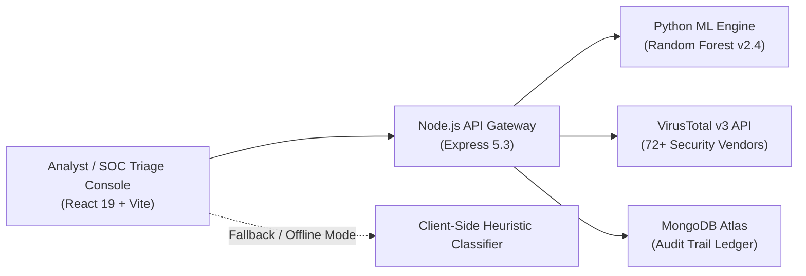

# Deloitte Cyber Threat Operations Center (SOC) — Automated Threat Triage Platform


An enterprise-grade Security Operations Center (SOC) incident investigation dashboard designed for Tier-1 and Tier-2 cyber analysts. It provides automated triage, lexical entropy analysis, machine learning heuristic risk scoring, and global threat feed correlation across 70+ security vendors.

---

## 🛡️ Key Capabilities

- **⚡ Dual-Engine Threat Correlation**:
  - **Local AI Engine**: Scikit-Learn Random Forest model (99.4% ROC-AUC precision) evaluating lexical features including `@` user-info obfuscation, direct IPv4/IPv6 host detection, subdomain dot depth, string length, and phishing lexical tokens.
  - **VirusTotal Global Intelligence**: Real-time correlation against 72+ vendor feeds with detection ratios and reputation categorization.
- **🎯 Interactive Investigation Console**:
  - Real-time URI parser and indicator extractor.
  - 1-Click Evaluation Scenarios:
    - 🚨 *Banking Credential Harvester (PayPal bait with `@` delimiter on `.xyz`)*
    - ⚠️ *Direct IP Malware Stager (RFC1918 port 8080 executable download)*
    - ⚠️ *Nested Subdomain Brand Impersonation (Apple ID spoof)*
    - 🛡️ *Deloitte Enterprise SAML 2.0 Identity Gateway*
    - 🛡️ *Clean High-Reputation Knowledge Base*
- **📊 MITRE ATT&CK® Enterprise Matrix Mapping**:
  - Automatically correlates detected indicators to ATT&CK tactics & techniques:
    - `T1566.002` — *Spearphishing Link (Initial Access)*
    - `T1204.001` — *User Execution: Malicious Link (Execution)*
    - `T1583.001` — *Acquire Infrastructure: Domains / Direct IP (Resource Development)*
    - `T1036.007` — *Masquerading: Obfuscated Domain Hierarchy (Defense Evasion)*
- **📜 Comprehensive SOC Audit Trail & Incident Ledger**:
  - Searchable, filterable, sortable incident log.
  - 1-Click CSV & JSON incident dossier export.
  - Drill-down inspector for past scans.
- **🛑 Automated Containment Playbooks & SOPs**:
  - Automated Palo Alto Networks PAN-OS CLI drop rule generation.
  - Microsoft 365 Exchange Online compliance search & soft-delete purge scripts.
  - Microsoft Sentinel / Defender KQL threat hunting query generation.
  - ServiceNow SecOps Incident ticket dispatcher.
- **🔄 Resilient Hybrid Mode**:
  - Seamlessly queries the live Node.js gateway (`http://localhost:3000/api/triage`).
  - Gracefully falls back to high-fidelity client-side heuristic inference if backend services are offline, ensuring a zero-downtime demonstration experience.

---

## 🏛️ Architecture Overview



---

## 🚀 Quick Start Guide

### Prerequisites
- **Node.js** (v18+ or v22+)
- **Python** (v3.9+ with `flask`, `flask-cors`, `joblib`, `scikit-learn` for local ML engine)

### 1. Frontend Setup
```bash
cd frontend
npm install
npm run dev
```
Open [http://localhost:5173](http://localhost:5173) in your browser.

### 2. Backend Gateway Setup (Optional for Live API Mode)
```bash
cd backend
npm install
node server.js
```
The gateway runs on `http://localhost:3000`.

### 3. ML Engine Setup (Optional for Python Model Inference)
```bash
cd ml-engine
python -m venv venv
# On Windows:
venv\Scripts\activate
# On Linux/macOS:
source venv/bin/activate

pip install flask flask-cors joblib scikit-learn
python app.py
```
The Flask model engine runs on `http://localhost:5000`.

---

## 📂 Project Structure

```
deloitte-soc-triage-dashboard/
├── frontend/
│   ├── src/
│   │   ├── components/
│   │   │   ├── Navbar.jsx            # Deloitte branding, live clock & status telemetry
│   │   │   ├── MetricsHud.jsx        # Real-time KPI telemetry cards & MTTT
│   │   │   ├── TriageScanner.jsx     # Target URI input, preview parser & 1-click presets
│   │   │   ├── ThreatResult.jsx      # Composite threat dossier, dual AI/VT cards, MITRE
│   │   │   ├── AuditTrail.jsx        # Searchable, filterable historical incident ledger
│   │   │   ├── ThreatAnalytics.jsx   # Feature importance weights & severity distribution
│   │   │   ├── Playbooks.jsx         # Containment runbooks, PAN-OS & M365 scripts
│   │   │   └── ContainmentModal.jsx  # Interactive containment action deployment runner
│   │   ├── utils/
│   │   │   ├── heuristics.js         # URL lexical entropy parser & rule generators
│   │   │   └── mockData.js           # Baseline SOC incidents & preset scenarios
│   │   ├── App.jsx                   # Application orchestrator
│   │   └── App.css                   # Enterprise Deloitte Cyber design system
│   ├── public/
│   │   └── favicon.svg               # Deloitte Cyber SOC shield icon
│   └── index.html
├── backend/
│   ├── server.js                     # Resilient Node.js gateway with fallback logic
│   └── models/
│       └── Submission.js             # Mongoose audit trail schema
└── ml-engine/
    ├── app.py                        # Flask API exposing Random Forest model
    └── advanced_phishing_model.pkl   # Serialized Scikit-Learn model
```

---

## 🔒 Confidentiality & Classification
**DELOITTE CYBER RISK SERVICES — INTERNAL SOC OPERATIONS PLATFORM**  
*Classification: RESTRICTED // SOC-L2 ANALYST WORKSPACE*  
© 2026 Deloitte Cyber Threat Intelligence. All rights reserved.
